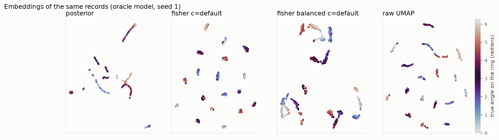
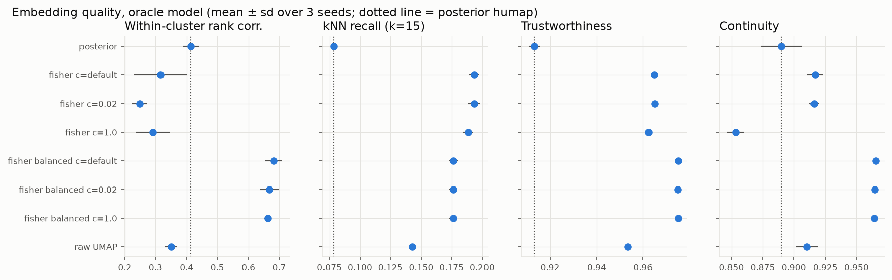
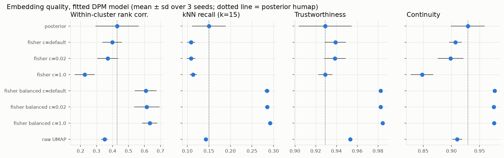
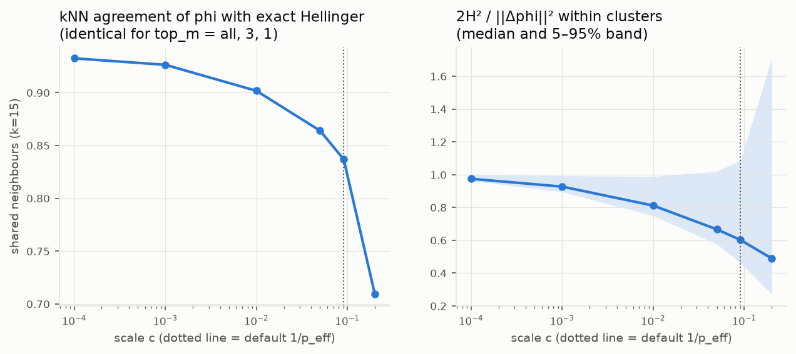
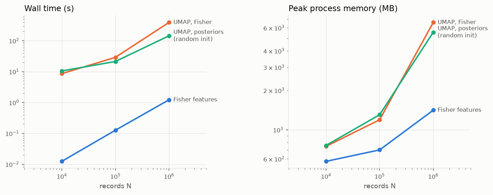

# Benchmark: Fisher humap vs posterior humap and raw features

Issue: llnl/dmx-learn#291 (epic llnl/dmx-learn#276). Design:
[`docs/utils/fisher_embedding.rst`](../docs/utils/fisher_embedding.rst) and
[`HUMAP_FISHER_ROADMAP.md`](../HUMAP_FISHER_ROADMAP.md).

This page is a numeric benchmark rather than an agent prompt, so the agent
answer rubric in [evaluation-rubric.md](evaluation-rubric.md) does not apply.
It follows the same spirit: a reproducible setup, the comparison that matters,
regression checks, and a recommendation.

## Summary

- **Fisher humap with `balance_fields=True` recovers the within-cluster
  structure that posterior humap loses.** Within-cluster rank correlation with
  the true ring position rises from 0.41–0.43 (posterior humap) to 0.61–0.68,
  and trustworthiness and continuity reach 0.975–0.984. This holds with an
  oracle model and with the DPM that `humap` fits by default.
- **Pure Fisher weighting (the `humap` default before this benchmark) is not
  enough on heterogeneous records.** A 6-level categorical field contributes up to
  `1/q_a + 1/q_b ≈ 12` to a squared distance, which swamps the two Gaussian
  fields. Each ring then breaks into one blob per level. Pure Fisher improves
  local neighbourhoods with the oracle model, but it loses to posterior humap
  on within-cluster rank correlation, and with a fitted DPM it does not beat
  posteriors on any metric.
- **The scale `c` hardly matters** for balanced features (0.02 to 1), as the
  theory predicts. **`top_m` 1, 3 or all give identical features** on this
  data.
- **The Euclidean feature map tracks the exact Hellinger reference.** At the
  default scale, 84% of each record's 15 nearest neighbours agree with the
  reference, and agreement rises to 93% as `c → 0`.
- **Posterior humap fails outright at scale.** With well-separated clusters,
  about a third of the posteriors are exactly one-hot. UMAP's spectral
  initialization then returns NaN at 10⁴, 10⁵ and 10⁶ records; it worked at
  2000 records with a fixed seed. This is the degenerate local connectivity
  described in roadmap section 3. The Fisher features have no such ties, and
  UMAP fits them at every size.
- **The embedding stage is cheap.** Fisher features for 10⁶ records take
  1.2 s and about 630 MB on one core, or 0.4 s on 4 MPI ranks. UMAP dominates
  the cost: 391 s and a 6.6 GB peak at 10⁶.

**Recommended defaults:** `fisher_scale=None` (`1 / p_eff`) and `top_m=3` are
confirmed. **`balance_fields=True` is now the default** for `humap` and
`humap_mpi` when `fisher_options` is None (roadmap F9); pass
`FisherScoreOptions()` for pure Fisher weighting. The results below were
produced with explicit options, so they do not depend on that default.

## Setup

**Data** (`tests/utils/fisher_benchmark.py::generate_ring_clusters`). Records
are `(x, y, level, count)` from three clusters with known internal structure:

- each cluster is a ring of radius 3 in `(x, y)` with noise sd 0.3; the
  centers are 12 apart;
- the categorical `level` (6 levels) names the 60° arc of the ring the record
  is on, with probability 0.85, and is uniform otherwise;
- `count` is Poisson with a cluster rate (3, 8, 15) that swings ±50% around
  the ring.

The ground truth is each record's cluster and its angle on the ring.

**Models.**

- *Oracle*: one composite component per true cluster, moment matched, with a
  Gaussian for each of `x` and `y`, a categorical and a Poisson
  (`oracle_mixture`).
- *DPM*: what `humap` fits by default: a bstats Dirichlet-process mixture with
  `max_components=20` and `max_its=200`. It kept 7–9 components, splitting
  each ring into arcs.

**Methods.**

- posterior humap (the default representation);
- Fisher humap with pure Fisher weighting (`FisherScoreOptions()`), at
  `c = 1/p_eff`, 0.02 and 1.0;
- Fisher humap with `balance_fields=True`, at the same scales;
- UMAP on standardized `x`, `y`, `count` plus a one-hot `level`.

All runs use `n_neighbors=15` and `min_dist=0.1`.

**Metrics** (k = 15). All are computed against the ground truth, with records
placed on a unit circle by angle and clusters 14 apart.

- *Trustworthiness* penalizes false neighbours; *continuity* penalizes torn
  neighbourhoods.
- *kNN recall* is the fraction of true neighbours kept.
- *Within-cluster rank correlation* is the Spearman correlation, over random
  pairs in the same cluster, between embedding distance and true chord
  distance on the ring.

**Reference metric** (`fisher_hellinger_reference`). Exact squared Hellinger
distance between the records' tilted local models `Q_i` (roadmap 2.1), with
closed-form Bhattacharyya coefficients for the Gaussian, Poisson and
categorical leaves and `eps = 2 sqrt(c)`.

N = 2000 records, seeds 1–3 (mean ± sd). The reference comparison uses
N = 1000 and seed 1. Machine: Apple Silicon (arm64, 14 cores, 36 GB), Python
3.13, NumPy 2.3, umap-learn 0.5.11.

## Results

### Embeddings



Posterior humap draws each cluster as a few thin curves. Pure Fisher splits
each ring into one blob per categorical level, because a level change outweighs
any change in position. Balanced Fisher keeps the rings as arcs ordered by
angle.

### Quality, oracle model



| method | Within-cluster rank corr. | kNN recall (k=15) | Trustworthiness | Continuity |
|---|---:|---:|---:|---:|
| posterior | 0.413 ± 0.026 | 0.078 ± 0.003 | 0.913 ± 0.002 | 0.890 ± 0.016 |
| fisher c=default | 0.316 ± 0.086 | 0.193 ± 0.004 | 0.965 ± 0.001 | 0.917 ± 0.006 |
| fisher c=0.02 | 0.249 ± 0.025 | 0.194 ± 0.005 | 0.965 ± 0.001 | 0.916 ± 0.004 |
| fisher c=1.0 | 0.292 ± 0.053 | 0.189 ± 0.004 | 0.962 ± 0.001 | 0.853 ± 0.007 |
| fisher balanced c=default | **0.682 ± 0.028** | 0.176 ± 0.004 | **0.975 ± 0.000** | **0.965 ± 0.001** |
| fisher balanced c=0.02 | 0.668 ± 0.030 | 0.176 ± 0.004 | 0.975 ± 0.000 | 0.965 ± 0.001 |
| fisher balanced c=1.0 | 0.662 ± 0.011 | 0.176 ± 0.003 | 0.975 ± 0.000 | 0.964 ± 0.001 |
| raw UMAP | 0.350 ± 0.020 | 0.143 ± 0.003 | 0.953 ± 0.001 | 0.910 ± 0.009 |

### Quality, fitted DPM (7–9 components)



| method | Within-cluster rank corr. | kNN recall (k=15) | Trustworthiness | Continuity |
|---|---:|---:|---:|---:|
| posterior | 0.428 ± 0.135 | 0.150 ± 0.039 | 0.929 ± 0.025 | 0.929 ± 0.030 |
| fisher c=default | 0.398 ± 0.061 | 0.109 ± 0.009 | 0.939 ± 0.010 | 0.907 ± 0.011 |
| fisher c=0.02 | 0.370 ± 0.065 | 0.108 ± 0.010 | 0.938 ± 0.010 | 0.898 ± 0.023 |
| fisher c=1.0 | 0.226 ± 0.063 | 0.114 ± 0.008 | 0.929 ± 0.007 | 0.848 ± 0.020 |
| fisher balanced c=default | 0.608 ± 0.068 | 0.285 ± 0.006 | 0.983 ± 0.001 | **0.977 ± 0.002** |
| fisher balanced c=0.02 | 0.614 ± 0.080 | 0.285 ± 0.005 | 0.982 ± 0.001 | 0.975 ± 0.003 |
| fisher balanced c=1.0 | **0.633 ± 0.047** | **0.292 ± 0.004** | **0.984 ± 0.001** | 0.975 ± 0.001 |
| raw UMAP | 0.350 ± 0.020 | 0.143 ± 0.003 | 0.953 ± 0.001 | 0.910 ± 0.009 |

With the DPM, posteriors already carry some position information, because
components cover arcs of each ring. That explains the larger posterior
variance across seeds. Balanced Fisher still wins clearly.

### Approximation: Euclidean features vs exact Hellinger



| scale c | kNN agreement (k=15) | median 2H²/‖Δφ‖² within clusters | 5–95% |
|---:|---:|---:|---|
| 0.0001 | 0.933 | 0.975 | 0.963–0.998 |
| 0.001 | 0.926 | 0.927 | 0.895–0.993 |
| 0.01 | 0.902 | 0.812 | 0.750–0.989 |
| 0.05 | 0.864 | 0.667 | 0.577–1.020 |
| 0.0909 (default) | 0.837 | 0.602 | 0.462–1.088 |
| 0.2 | 0.709 | 0.490 | 0.271–1.709 |

`top_m` = all, 3 and 1 give identical numbers: with separated clusters, the
other components' posteriors are around 1e-14, so their score blocks change
squared distances by less than 1e-12. The ratio tends to 1 as `c → 0`, which confirms the second-order expansion
(roadmap 2.2). At the default scale, the exact metric saturates for large
score differences (Hellinger is bounded), so the ratio falls below 1. The
neighbour sets still agree on 84%.

### Scaling (one node)



| N | stage | wall time (s) | peak RSS (MB) | stage peak increase (MB) |
|---:|---|---:|---:|---:|
| 10,000 | Fisher features | 0.01 | 574 | 21 |
| 10,000 | UMAP on posteriors | failed (NaN in spectral init) | – | – |
| 10,000 | UMAP on posteriors, random init | 10.5 | 760 | 209 |
| 10,000 | UMAP on Fisher features | 8.6 | 747 | 171 |
| 100,000 | Fisher features | 0.13 | 702 | 136 |
| 100,000 | UMAP on posteriors | failed (NaN in spectral init) | – | – |
| 100,000 | UMAP on posteriors, random init | 21.3 | 1,303 | 733 |
| 100,000 | UMAP on Fisher features | 28.9 | 1,193 | 494 |
| 1,000,000 | Fisher features | 1.2 | 1,411 | 631 |
| 1,000,000 | UMAP on posteriors | failed (NaN in spectral init) | – | – |
| 1,000,000 | UMAP on posteriors, random init | 144.2 | 5,550 | 4,719 |
| 1,000,000 | UMAP on Fisher features | 391.0 | 6,593 | 5,170 |
| 1,000,000 | Fisher features, `fisher_embedding_mpi`, 1 rank | 1.3 | 2,188 | – |
| 1,000,000 | Fisher features, `fisher_embedding_mpi`, 4 ranks | 0.4 | 1,444 per rank | – |

Each stage ran in a fresh process; peak RSS includes the records and model,
and the last column is the increase during the stage. Posteriors take 0.3 s at
10⁶. The features have 36 columns and 36 nonzeros per row (3 components). UMAP
on the sparse Fisher features is about 2.7× slower than on the 3-column
posteriors at 10⁶, because the features carry more information. The MPI runs
used `NUMBA_DISABLE_JIT=1`.

## Regression test

`tests/utils/test_fisher_humap_benchmark.py` runs in CI in about 20 s. Over
three seeds of 400 records with the oracle model, balanced Fisher humap must
beat posterior humap on within-cluster rank correlation by more than 0.1 on
average. In development the gap was 0.08–0.28 per seed, about 0.2 on average.
The file also checks the generator, the reference metric (2H² ≈ ‖Δφ‖² as
`c → 0`) and the metrics.

## Reproduce

```bash
PYTHONPATH=.:src python _benchmarks/fisher_humap/run_benchmark.py quality
PYTHONPATH=.:src python _benchmarks/fisher_humap/run_benchmark.py approximation
PYTHONPATH=.:src python _benchmarks/fisher_humap/run_benchmark.py scaling
NUMBA_DISABLE_JIT=1 PYTHONPATH=.:src mpiexec -n 4 python _benchmarks/fisher_humap/run_benchmark.py mpi --n 1000000
PYTHONPATH=.:src python _benchmarks/fisher_humap/run_benchmark.py figures
PYTHONPATH=.:src python _benchmarks/fisher_humap/run_benchmark.py tables
```

Figures need the `viz` extra (matplotlib). Raw results are in
[`fisher_humap/results/`](fisher_humap/results/).

## Limitations

- One synthetic family. Real data with high-cardinality categoricals, missing
  values or sequences may favour different settings; repeat on real data
  before changing library defaults.
- The DPM was fitted with a capped iteration count to keep the benchmark
  short.
- UMAP timings are single runs on one machine, with numba threading.
